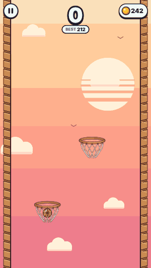
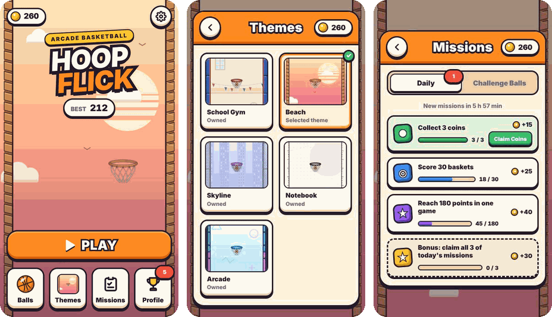

# Hoop Flick

Hoop Flick is a mobile-first HTML5 basketball arcade game. Pull the ball back, aim along the preview dots and flick it into the next hoop. Keep climbing, chain clean swishes to set the ball on fire, and bank shots off the walls for double points.

## Play Now

No installation is required:

### [▶ Play Hoop Flick in your browser](https://bugrackm.github.io/Hoop-Flick/)

<p align="center">
  
</p>

The game works with mouse and touch controls. In my experience a mouse gives the most precise shots, but it plays well in mobile browsers too.

## How to Play

1. Press **Play** on the main menu.
2. Touch or click the ball and drag back to aim. The dots show where it will fly.
3. Release to shoot and land the ball in the next hoop.
4. Keep climbing as high as you can.

The first launch opens a short lesson: a ghost hand shows the pull, you score once, then sink a clean swish, and the game takes you to the main menu. It can be replayed any time from **Settings**.

## Features

- **Flick physics:** drag-and-release shots with a preview that matches the real flight exactly. The hoop holding the ball turns to face your shot in any direction.
- **A climb that gets harder:** a new challenge arrives at fixed scores and shows up alone first: tilted, sliding, swinging, rising, orbiting and spinning hoops, blocking bars, bumpers, sliding bars and spinners. Every moving hazard shows its full path before you shoot.
- **High drops:** a basket that falls in from very high scores one extra point.
- **Swish streaks:** clean shots that don't touch the rim score more, and a chain of them sets the ball on fire.
- **Bank shots:** bounce the ball off a wall for double points.
- **Timed shots:** later in a run some hoops come with a countdown.
- **Daily missions:** three new missions every day, with coin rewards and a bonus for finishing all three.
- **Collectibles:** coins in the world, 14 shop balls, and 6 challenge balls you can only earn by completing their tasks.
- **Five hand-drawn themes:** School Gym, Beach, Arcade, Skyline and Notebook. Each has its own walls, background and sound, in light and dark mode.
- **Achievements and stats:** milestones with coin rewards, a profile with lifetime statistics, and local high scores.
- **Feel:** cel-shaded art throughout, plus impact sounds, vibration on Android, squash and stretch, and hit-stop.
- **Languages and devices:** Turkish and English; runs on phones, tablets and desktops.

<p align="center">
  
</p>

## Run Locally

Clone the repository:

```bash
git clone https://github.com/bugrackm/Hoop-Flick.git
cd Hoop-Flick
```

Start a local server:

```bash
python3 -m http.server 8000
```

Then open:

```text
http://localhost:8000/
```

Stop the server with `Ctrl+C`.

Hoop Flick uses plain HTML, CSS and JavaScript, so there is no package installation or build step.

### Tests

The tests use Node's built-in test runner (Node 18 or newer) and need no dependencies:

```bash
node --test "tests/*.test.mjs"
```

## Project Structure

```text
Hoop-Flick/
├── index.html        # Game interface, HUD and menus
├── style.css         # Responsive cel-style UI, light and dark mode
├── physics.js        # Fixed-step ball flight shared by shots, preview and spawning
├── ballArt.js        # Cel-shaded ball skins
├── hoopArt.js        # Cel-shaded hoops and animated nets
├── themeArt.js       # Theme backgrounds and side walls
├── game.js           # Gameplay, rendering, audio, progression, missions and tutorial
├── favicon.png       # Game icon
├── tests/            # Node test suite
└── docs/media/       # README images
```

## License

All rights reserved.
